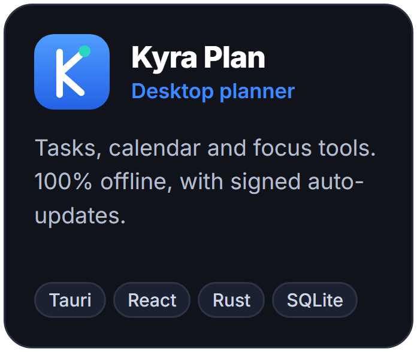
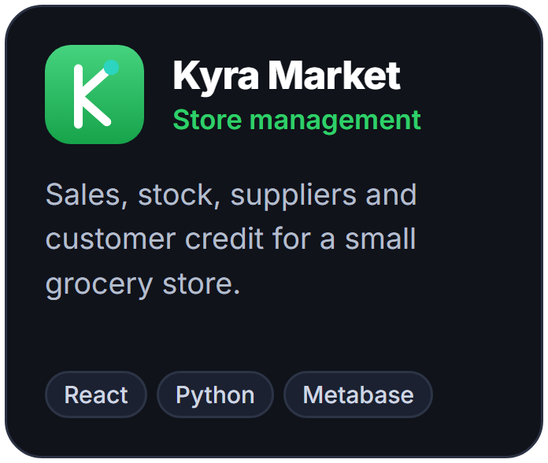
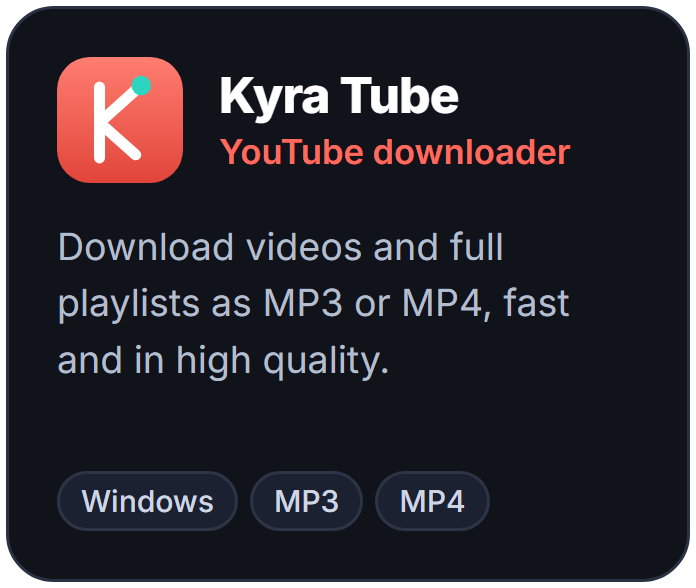

# Kauê Fernandes

**Software developer** · desktop apps, bots and web tools 
Software Engineering student at Ibmec · Developer at Ibmec Jr Soluções 
Clean code, careful UI, products that ship.

Looking for a software development internship in Rio de Janeiro (on-site, hybrid or remote). Open to collaborating on open source.

