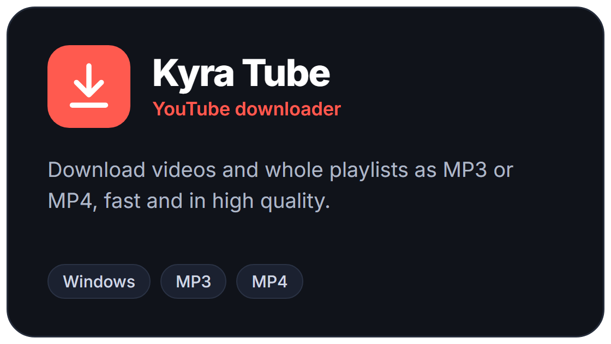
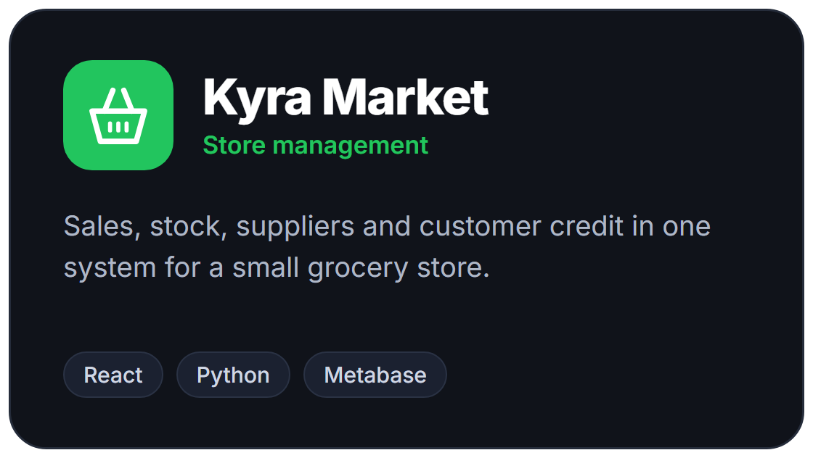

# Kauê Fernandes

**Software developer** · desktop apps, bots and web tools 
Clean code, careful UI, products that ship.

 

 

  

 

[Try Kyra Plan in the browser](https://kauefss.github.io/Kyra-Plan/) · [Download for Windows](https://github.com/KaueFSS/Kyra-Plan/releases/latest)

 

Open to opportunities and to collaborating on open source.

